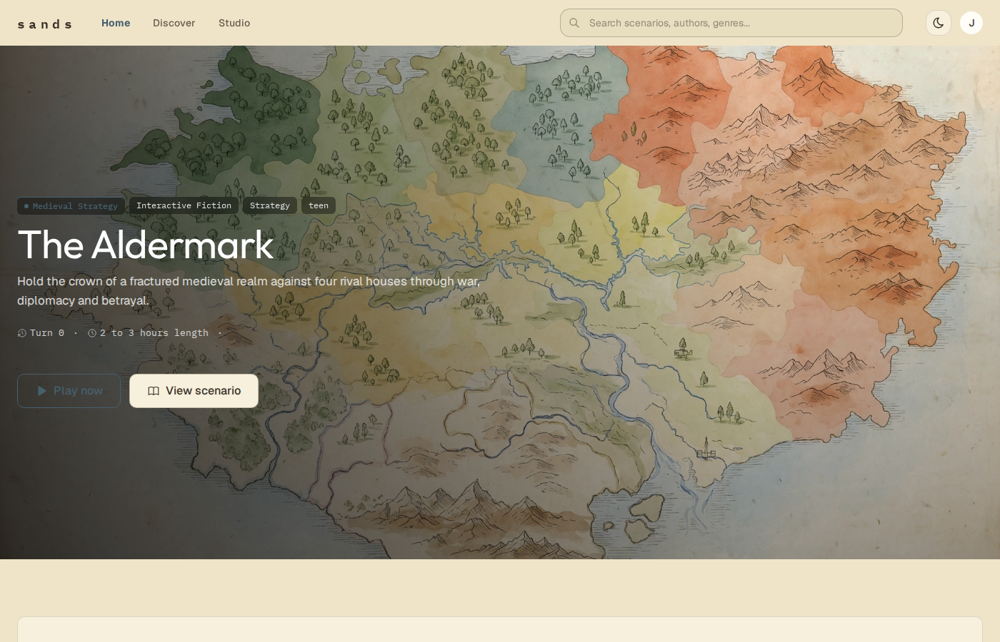
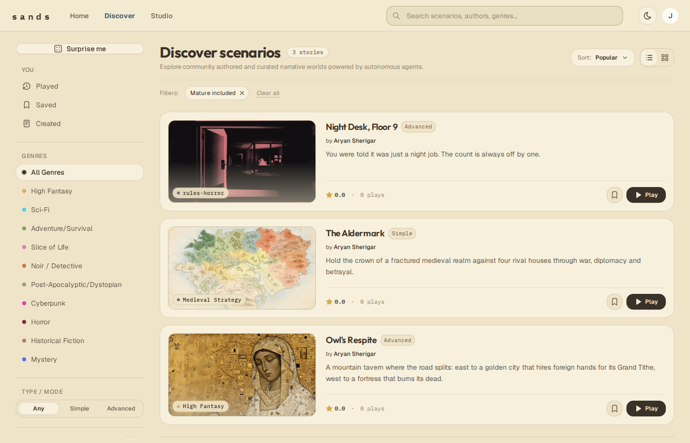
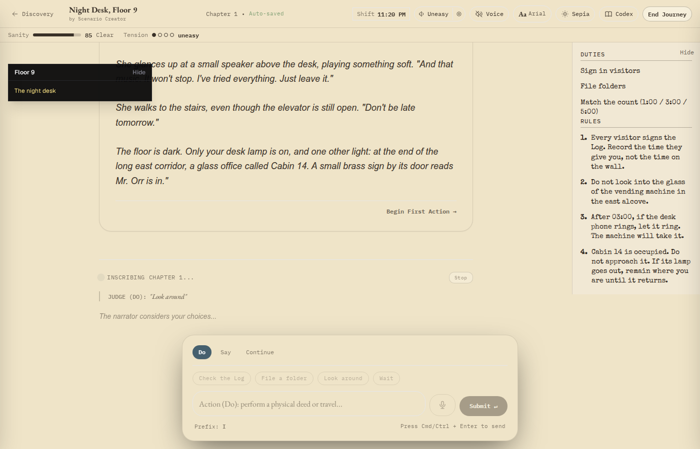
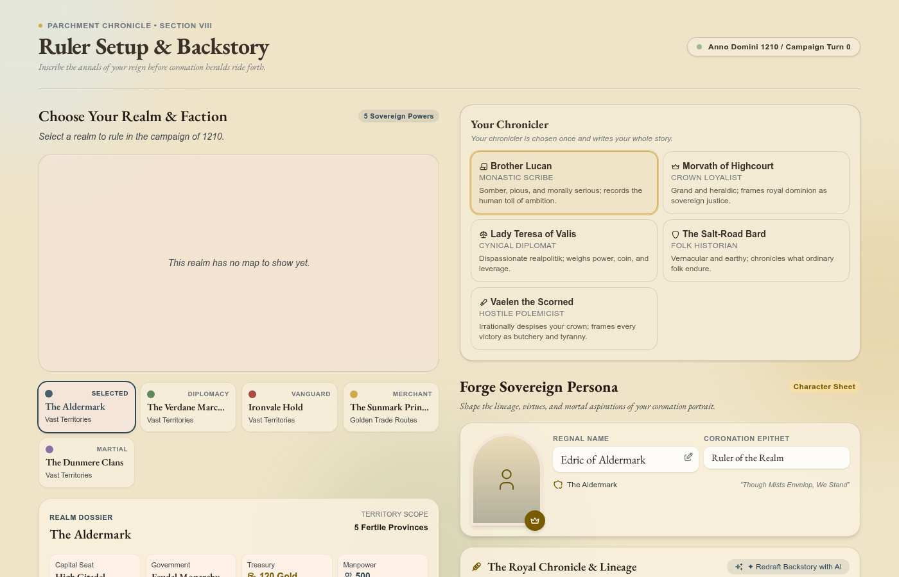

# Sands

**Make and play interactive fiction and grand strategy, where Meta's models narrate and the engine decides.**

**[Play it live → sands-demo.pages.dev](https://sands-demo.pages.dev)** · Demo video: [Watch on YouTube](https://youtu.be/mAiwhUCmJeA)



---

## Why this is new

I've played more than 150,000 turns of AI Dungeon. Two things always broke it: characters forgot who they were, and the AI decided everything, so my choices never really counted.

Grand strategy games like Europa Universalis, Crusader Kings, Rebel Inc and Plague Inc have the opposite problem. Their simulations run deep, but their most dramatic moments (peace talks, surrenders, rebellions, judgments) collapse into a menu, a number and a yes/no button. Years of player complaints on r/CrusaderKings, r/eu4, r/victoria3 and r/totalwar ask for the same things: a moderate peace, rebels you can reason with, rivals who remember.

Sands solves both with one rule: **the model plays the people, the engine keeps the books.** Meta's Muse models write every line a character says, every page of story and every painted map. A deterministic engine decides what actually happens, and Muse cannot change a number on its own. The result is a story that remembers and a world whose rules hold, and anyone can build one.

## Three things you can do

### Create

- **Start from one sentence.** Studio walks you through a modified Snowflake method: a premise, then a player, characters, world and opening. A Muse co-writer suggests changes, and nothing applies until you approve it.
- **Add real rules.** Advanced mode adds tracked values, invariants, win and lose endings, and minigames that decide key outcomes.
- **Describe a land, get a map.** For strategy, type one sentence. Muse Image draws a region map, then repaints that same image as an antique atlas, and Sands traces it into playable provinces. Add rulers with Muse-drafted backstories and Muse-painted portraits, which are rigged into animated avatars.
- **Publish it.** Other players find it in Discover and play it.



### Play interactive fiction

- **Characters who remember.** A dedicated memory service extracts facts from play and brings them back with hybrid vector, keyword and graph search, so a character is still themselves a hundred turns later.
- **Choices that count.** Muse can only propose state changes through validated tool calls. The server rolls the dice, and minigames decide the big moments: a bullet-hell dodge, a lockpick, a rhythm test of nerve.
- **Rules-horror.** In *Night Desk, Floor 9*, you follow the rules of the job or pay for it, and the server enforces them.
- **Living pages.** Scene art, music that follows the mood, and spoken input.



### Play grand strategy

Each of the most common complaints in that community research has an answer in Sands:

| Players complained about | In Sands |
|---|---|
| All-or-nothing war score | Sue for peace across the table and draft multi-clause treaties with conditions and sworn promises |
| Revolt meters you can only suppress | Talk to the rebel spokesperson and agree a covenant; break it and the revolt comes back stronger |
| Grudges that fade on a timer | Rivals cite old wrongs in their own words, and heirs inherit them |
| Seeing everything at once | A spymaster whose report may be a lie because the engine bribed him |
| Dry event logs | Pick one of five biased chroniclers, from a pious monk to an exile who hates your crown, to write the history of your reign |

You also pass judgment with a mercy advisor and an iron advisor, speak battle speeches aloud and have them graded into troop morale, and issue proclamations to your court. Type "accept all my terms" and the rival refuses in character, because the engine sets the limits. Every playthrough can be replayed and verified by hash.



## Features

**Authoring (Studio)**
- Guided scenario creation from one sentence, with a Muse co-writer whose suggestions apply only when you approve them
- Advanced mode: tracked values, invariants, win and lose endings, and minigames
- Strategy maps generated from a sentence, repainted as an antique atlas and traced into playable provinces
- Factions, leaders, armies, economy and starting grudges, with publish checks that block an unplayable scenario
- Rulers with Muse-drafted backstories, Muse-painted portraits and animated avatars
- Publish to Discover for other players

**Interactive fiction**
- Long-term memory with hybrid vector, keyword and graph retrieval
- Validated tool calls: Muse proposes state changes, the server decides
- Minigames that settle key moments: dodge, lockpick and rhythm
- Rules-horror with server-enforced rules
- Streaming narration, scene art, mood-following music and spoken input
- Shared playthroughs with spectating and turn-based multiplayer

**Grand strategy**
- A deterministic, replayable engine: a world hash every turn, and replay verification on screen
- Economy with taxes, upkeep, loans and unrest, plus uprisings and events written by Muse
- Armies with route planning, fog of war, sieges and conquest
- A tactical war council for big battles, and a battle speech you speak aloud, graded into troop morale
- Negotiation with rival rulers: multi-clause treaties, conditional clauses and sworn promises
- Peace talks, alliances, coalitions and vassals, with prisoners, ransom, hostages and mediation
- War pressure, outrage and tone: rivals mobilise when pushed too far
- Revolt talks that end in covenants, which re-ignite the revolt a stage higher if broken
- Rivals who remember grievances, and heirs who inherit them
- A spymaster whose reports may be false, and letters between rulers
- Judgment with a mercy advisor and an iron advisor, and proclamations to your court
- A choice of five chroniclers, and an ending screen with a history book of your reign
- Deterministic adaptive music that follows threat, unrest, war and season

## Scenarios

Three scenarios, all built in Studio, show the range.

| Scenario | Mode | Premise |
|---|---|---|
| **The Aldermark** | Grand strategy | Hold the crown of a fractured medieval realm against four rival houses through war, diplomacy and betrayal. |
| **Night Desk, Floor 9** | Interactive fiction (rules-horror) | You were told it was just a night job. The count is always off by one. |
| **Owl's Respite** | Interactive fiction (high fantasy) | A mountain tavern where the road splits: east to a golden city that hires foreign hands for its Grand Tithe, west to a fortress that burns its dead. |

## Built with Meta's models

| Model | What it does in Sands |
|---|---|
| **Muse Spark** (`muse-spark-1.3`) | Narration, rival rulers in negotiation, peace, letters, judgment and revolt talks, the spymaster's dispatches, chronicles and the end-of-reign history book, rival stance and speech grading from fixed menus, memory extraction, the Studio co-writer and ruler backstories |
| **Muse Image** (`muse-image-1.0`) | A playable map from one sentence (generate the regions, then edit them into art), leader portraits for rigged avatars, covers, scene, event and chronicle art |
| **Muse Voice Transcribe** | Spoken actions and battle speeches |

We started on Gemini, ran Muse on the same turns, preferred its prose, and moved text, images and voice input to Meta. How each call stays inside the engine's rules is covered in [ARCHITECTURE.md → Meta model integration](ARCHITECTURE.md#meta-model-integration).

## Proof it's real

- **Five services:** React frontend; FastAPI core API, turn engine, memory and simulation. Deployed on Cloud Run behind a Cloudflare edge.
- **About 10,000 automated tests** across the services.
- **Memory eval:** 101 probes over frozen 60- and 120-turn campaigns. Recall was 1.00 in 8 of 11 question classes, no hidden fact leaked early, and extraction cost about $0.0007 per turn.
- **A pure, replayable strategy engine.** The world hash is recorded every turn, and import-linter contracts stop the engine from touching databases, network or models.

The full design, service by service, is in **[ARCHITECTURE.md](ARCHITECTURE.md)**.

## Try it

**Live:** open [sands-demo.pages.dev](https://sands-demo.pages.dev) and sign in. <!-- JUDGE SIGN-IN DETAILS --> Then play *The Aldermark* for grand strategy or *Night Desk, Floor 9* for interactive fiction, or open **Studio** to make your own.

**Local:**

```bash
cp .env.example .env    # add MUSE_API_KEY and the other keys listed in the file
docker compose up --build
# open http://localhost
```

## Third-party licenses

**Mesh Avatar Studio** (<https://github.com/shinshin86/mesh-avatar-studio>) by Yuki Shindo is the basis for the animated ruler avatars. Sands uses the `mesh-avatar-react` runtime and adapts parts of its rig calculation and `.mavatar` packaging in `apps/core-api/app/services/avatar_mesh_builder.py`. It is licensed under the MIT License:

```
MIT License

Copyright (c) 2026 Yuki Shindo

Permission is hereby granted, free of charge, to any person obtaining a copy
of this software and associated documentation files (the "Software"), to deal
in the Software without restriction, including without limitation the rights
to use, copy, modify, merge, publish, distribute, sublicense, and/or sell
copies of the Software, and to permit persons to whom the Software is
furnished to do so, subject to the following conditions:

The above copyright notice and this permission notice shall be included in all
copies or substantial portions of the Software.

THE SOFTWARE IS PROVIDED "AS IS", WITHOUT WARRANTY OF ANY KIND, EXPRESS OR
IMPLIED, INCLUDING BUT NOT LIMITED TO THE WARRANTIES OF MERCHANTABILITY,
FITNESS FOR A PARTICULAR PURPOSE AND NONINFRINGEMENT. IN NO EVENT SHALL THE
AUTHORS OR COPYRIGHT HOLDERS BE LIABLE FOR ANY CLAIM, DAMAGES OR OTHER
LIABILITY, WHETHER IN AN ACTION OF CONTRACT, TORT OR OTHERWISE, ARISING FROM,
OUT OF OR IN CONNECTION WITH THE SOFTWARE OR THE USE OR OTHER DEALINGS IN THE
SOFTWARE.
```
