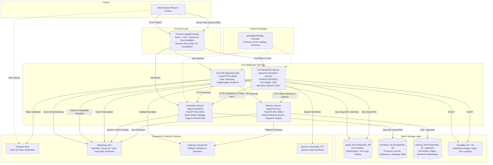

# System Architecture

High-level architecture, service topology, inter-service communications, databases, and external dependencies of the platform.

An interactive standalone diagram (with dark/light themes, component inspection, and path tracing) is available at [architecture.html](file:///data/sands-monorepo/apps/core-api/architecture.html).

---

## 1. High-Level System Architecture Diagram

---

## 2. Component Descriptions

### Frontend (`apps/frontend`)
- **Technology**: React 18, Vite, TypeScript, Tailwind CSS, Zustand, TanStack Query.
- **Role**: Client interface for scenario authoring (Studio) and gameplay (Play mode).
- **Communication**: Serves the single-page application and proxies HTTP and SSE requests to backend services:
  - `/api` routed to Core API (`core-api:8000`).
  - `/trs` routed to Turn Resolution Service (`turn-resolution-service:8001`).
  - `/simulation` routed to Simulation Service (`simulation:8081`).

### Core API (`apps/core-api`)
- **Technology**: Python 3.12+, FastAPI, SQLAlchemy (Async), Alembic, Pydantic v2.
- **Role**: Stateless REST service managing user identity, scenario CRUD, publishing flows, playthrough initialization, studio uploads, and leader backstory generation.
- **Boundaries**: Strictly request/response (no streaming). Communicates with `memory` and `simulation` via internal HTTP clients.

### Turn Resolution Service (`apps/turn-resolution-service`)
- **Technology**: Python 3.12+, FastAPI, SQLAlchemy (Async), Respx, Pydantic v2.
- **Role**: Stateful turn pipeline orchestrator for real-time game resolution:
  - Validates player input and evaluates active conditions.
  - Resolves combat encounters, movement, and minigame mechanics.
  - Retrieves playthrough lore and world facts from the Memory Service.
  - Streams real-time AI narration via Server-Sent Events (SSE).
  - Handles speech-to-text input (transcription) and text-to-speech audio delivery.
  - Emits memory outbox records to sync game events to long-term memory.

### Simulation Service (`apps/simulation`)
- **Technology**: Python 3.12+, FastAPI, asyncpg, PostgreSQL raw SQL repositories.
- **Role**: Deterministic strategy world engine maintaining authoritative campaign state:
  - Manages provinces, vassals, alliances, logistics, supply lines, battles, and fog-of-war visibility.
  - Evaluates AI ruler diplomatic stances using structured JSON LLM grading.

### Memory Service (`apps/memory`)
- **Technology**: Python 3.12+, FastAPI, async psycopg 3, PostgreSQL with pgvector.
- **Role**: World consistency and memory service:
  - Ingests narrative events asynchronously via the outbox pattern.
  - Runs batched LLM extraction to convert narrative prose into semantic facts.
  - Hybrid retrieval engine combining vector similarity, keyword matching, and graph traversal.

### Shared Contracts (`packages/strategy-contracts`)
- **Technology**: Python package, Pydantic v2.
- **Role**: Authoritative data schemas, domain entities, publish verification rules, and event catalogs shared across Core API, TRS, and Simulation.

---

## 3. Data & Persistence Layer

| Database / Store | Engine | Owning Services | Key Contents |
| :--- | :--- | :--- | :--- |
| `sands_db` | PostgreSQL 18 | `core-api`, `turn-resolution-service` | Users, Scenarios, Playthroughs, Turn Logs, Turn Metrics, Memory Outbox |
| `simulation_db` | PostgreSQL 18 | `simulation` | Campaign states, Provinces, Armies, Treaties, Diplomatic Outrage |
| `memory_db` | PostgreSQL 18 + `pgvector` | `memory` | Long-term memory facts, Graph relations, Semantic embeddings |
| Object Storage | Cloudflare R2 / S3 API | `core-api`, `turn-resolution-service` | Scene illustrations, Cover art, Voice audio files, Avatar images |

---

## 4. External Integrations

- **Firebase Auth**: Verifies Google client identity tokens and maps them to internal session claims.
- **Meta Muse API**:
  - Main AI narrator (OpenAI-compatible chat completions interface).
  - Image generation for covers and in-turn scene illustrations.
  - Voice transcription for spoken player actions.
  - Fact extraction for long-term memory.
- **Anthropic Claude API**: Secondary fallback narration provider and memory extraction engine.
- **Gemini / Fish Audio TTS**: Text-to-speech audio synthesis for narration output.
