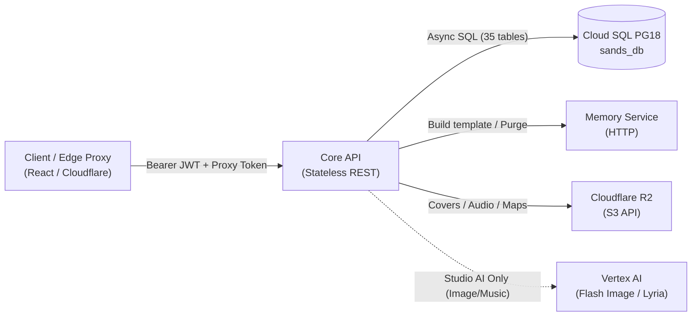

# Core API — 5-Minute Architecture & Developer Guide

> **Reading time:** ~5 minutes  
> **Service path:** [`apps/core-api/`](apps/core-api)  
> **Tech stack:** Python 3.11+, FastAPI, SQLAlchemy 2.0 (async), asyncpg, Alembic, Pydantic v2  
> **Primary contract:** [CLAUDE.md](CLAUDE.md) · [ARCHITECTURE.md](ARCHITECTURE.md)

---

## 1. Executive Summary & System Role

The **Core API** is the administrative, authoring, identity, and state discovery backbone of the **sands** platform. It handles all CRUD operations, scenario authoring in Studio, scenario publishing and memory compilation, discovery feeds, playthrough session initialization, ratings, and closed-alpha perimeter controls.



### What Lives Here vs. Elsewhere

| Service | Primary Responsibility | AI / Streaming Capabilities |
|---|---|---|
| **Core API** (`apps/core-api`) | Auth, Scenario authoring, Publishing, Discovery, Playthrough creation, Profile & Stats. | **Stateless request/response only.** No narration LLM. No SSE streaming. |
| **Turn Resolution Service (TRS)** (`apps/turn-resolution-service`) | Live turn execution loop, action validation, tool calls, and state progression. | **All narration AI.** Live SSE streaming (`POST /v1/turn`). Voice STT/TTS. |
| **Memory Service** (`apps/memory`) | Long-term episodic memory, outbox ingestion, graph/vector/keyword hybrid retrieval. | Vertex AI embeddings & fact extraction. Standalone HTTP service. |

---

## 2. Hard Boundaries & Invariants (Never Violate)

Every engineer and agent touching this service must respect these architectural invariants:

1. **Strictly Stateless HTTP**: Core API handles synchronous request/response cycles only. There are **no WebSockets and no SSE streaming endpoints** here (SSE belongs exclusively to TRS).
2. **Narration AI is Banned**: Core API **never** calls Gemini for storytelling, dialogue, or gameplay narration.
   - *The only approved AI exceptions* are narrow, Studio-only asset generation tasks:
     - **Cover Art**: [`image_gen_client.py`](apps/core-api/app/integrations/image_gen_client.py) using `gemini-3.1-flash-image` (called only from [`upload_service.py`](apps/core-api/app/services/upload_service.py)).
     - **Soundtrack Composition**: [`music_gen_client.py`](apps/core-api/app/integrations/music_gen_client.py) using `lyria-002` (called only from [`music_service.py`](apps/core-api/app/services/music_service.py)).
3. **Sole Owner of Migrations**: Core API owns all Alembic database migrations (`001` through `030`) for the shared relational database (`sands_db`). TRS shares this database but never defines migrations.
4. **Memory Boundary**: Never import or connect directly to the memory database (`memory_db`). All memory interactions go strictly through [`integrations/memory_client.py`](apps/core-api/app/integrations/memory_client.py) via HTTP.

---

## 3. The 4-Tier Layer Architecture

Core API strictly enforces unidirectional dependency flow:

$$\text{Router} \longrightarrow \text{Service} \longrightarrow \text{Repository} \longrightarrow \text{Database}$$

```
app/
├── routers/          # 24 routers: HTTP parsing, dependency injection, auth validation, response models
├── services/         # 28+ services: Business logic, validation, transactional orchestrations
├── repositories/     # 35 repositories: The ONLY place SQL / SQLAlchemy queries exist
├── integrations/     # 4 clients: Memory, R2 Storage, Vertex Image Gen, Vertex Lyria Music
├── db/
│   ├── models/       # 35 SQLAlchemy ORM models (durable database entities)
│   └── migrations/   # Alembic migration scripts (versions 001 - 030)
├── models/           # Pydantic v2 request/response schemas (boundary types, not ORM)
├── middleware/       # Auth context, rate limiting, proxy security, error handlers
└── exceptions/       # Custom domain exceptions inheriting from AppError
```

### Layer Rules at a Glance:

- **Routers**: Validate request parameters, inject async DB sessions (`get_db_session`), verify auth (`get_current_user`), call services, and return Pydantic models. **Routers never touch repositories or build SQL.**
- **Services**: Enforce domain validation, business rules, and multi-entity coordination. Services call repositories and external integrations. **Services never build raw SQL.**
- **Repositories**: Dumb data access. Each repository encapsulates queries for a specific entity. **Repositories never log, and never call other services.**
- **Integrations**: Translate between internal Pydantic domain models and external HTTP/S3 APIs. No business logic belongs here.

---

## 4. Key Functional Domains & Lifecycle Flows

### 4.1 Authentication & Token Rotation ([`routers/auth.py`](apps/core-api/app/routers/auth.py))
- **Exchange (`POST /v1/auth/token`)**: Client provides a Firebase ID token (Google Sign-In) and optional alpha invite code. Core API verifies Firebase identity, creates or loads the `User`, and issues:
  - An internal short-lived **access token** (HS256 JWT, 15-minute expiry).
  - An HTTP-only **refresh token cookie** (7-day expiry with 30-second rotation grace window).
- **Instant Revocation**: Every user record tracks `token_version`. Core API checks `token_version` on every authenticated request, allowing immediate session invalidation without distributed token blacklists.

### 4.2 Studio Scenario Authoring & Master Mode Graph
Authors create rich, structured interactive scenarios using dedicated domain routers:
- **Base Entities**: [`scenarios.py`](apps/core-api/app/routers/scenarios.py), [`entities.py`](apps/core-api/app/routers/entities.py), and [`facts.py`](apps/core-api/app/routers/facts.py).
- **Master-Mode Rules & State**: [`conditions.py`](apps/core-api/app/routers/conditions.py) (state mutations), [`invariants.py`](apps/core-api/app/routers/invariants.py) (bounds enforcement), and [`end_conditions.py`](apps/core-api/app/routers/end_conditions.py) (win/loss rules).
- **Interactivity & Maps**: [`minigames.py`](apps/core-api/app/routers/minigames.py) (`dodge` and `lockpick` canvas mini-games), [`maps.py`](apps/core-api/app/routers/maps.py) (locations, pins, connections), [`rule_checks.py`](apps/core-api/app/routers/rule_checks.py), and [`sheet_rules.py`](apps/core-api/app/routers/sheet_rules.py).
- **Soundtrack & Ambience**: [`scenario_music.py`](apps/core-api/app/routers/scenario_music.py) and [`music_defaults.py`](apps/core-api/app/routers/music_defaults.py) managing mood slots (`peaceful`, `mystery`, `tension`, `combat`, `melancholy`, `triumph`).

### 4.3 Scenario Publish Lifecycle ([`publish_service.py`](apps/core-api/app/services/publish_service.py))
When a creator publishes a scenario (`POST /v1/scenarios/{id}/publish`):
1. **Edit Guard**: Acquires a write lock on the scenario (`scenario_edit_guard.py`), preventing concurrent edits.
2. **Integrity Validation**: Verifies state schema paths, initial state completeness, and condition syntax.
3. **Memory Template Build**: Compiles authored entities and facts into a memory template and submits it to Memory Service via [`memory_client.py`](apps/core-api/app/integrations/memory_client.py) (`POST /v1/templates`).
   - *Master mode*: Direct 1:1 schema mapping with no LLM extraction (preserves author intent exactly).
   - *Newbie mode*: Freeform lore chunked for background extraction.
4. **Publish Snapshot**: Freezes a full JSON snapshot of rules, entities, and tools, and increments `publish_revision`.

### 4.4 Playthrough Lifecycle & Memory Outbox ([`playthrough_service.py`](apps/core-api/app/services/playthrough_service.py))
- **Initialization (`POST /v1/playthroughs`)**: Instantiates `Playthrough`, snapshots the published scenario configuration, copies initial state, pins the scenario's `memory_publish_revision`, and enqueues a `registration` event in `memory_outbox`.
- **Multiplayer Participation**: Manages turn order and roles (`owner` vs. `joined`) in the `participants` table. Share tokens generated in [`share.py`](apps/core-api/app/routers/share.py) permit joining or spectating.
- **Memory Outbox Contract**: All durable events destined for the memory service (`registration`, `turn`, `flush`, `participants`) are staged transactionally in `memory_outbox` table in `sands_db`, guaranteeing at-least-once delivery.

### 4.5 Closed-Alpha Perimeter & Analytics
- [`alpha.py`](apps/core-api/app/routers/alpha.py): Gated configuration, invite codes validation, and user consent records.
- [`alpha_events.py`](apps/core-api/app/routers/alpha_events.py): Ingests client telemetry into `alpha_events`.
- [`alpha_feedback.py`](apps/core-api/app/routers/alpha_feedback.py): Turn-specific narration flags, user feedback, and post-run surveys.
- [`creator_stats.py`](apps/core-api/app/routers/creator_stats.py): Aggregate performance metrics, playthrough drop-off funnels, and ratings distribution.

---

## 5. Engineering Standards & Coding Rules

All contributions must comply with [CLAUDE.md](CLAUDE.md):

- **Nesting Depth**: Maximum 2 levels deep. If you need a third level, extract a helper function.
- **Function Size**: Under 30 lines. Functions doing both I/O and transformation must be split.
- **Async I/O Everywhere**: Use `async`/`await` across all DB calls (`AsyncSession`), HTTP clients (`httpx.AsyncClient`), and file operations. Never block the event loop.
- **Strict Typing**: Full type annotations on all parameters and return values. No `typing.Any` (use explicit models or `dict[str, object]`). Use `T | None` union syntax.
- **Error Handling**: Raise explicit domain exceptions from `app/exceptions/` (inheriting from `AppError`). They are converted to RFC 7807 problem responses by `app/middleware/error_handler.py`.
- **Comments & Docstrings**: Never restate what the code does. Add comments only for non-obvious trade-offs (`# NOTE:` or `# TRADE-OFF:`). Never place comments inside query strings.

---

## 6. Developer Cheatsheet & Common Commands

Run all commands from `apps/core-api/` (or repo root as indicated):

### Environment Setup & Running Locally
```bash
# From apps/core-api with virtual environment activated:
uvicorn app.main:app --host 0.0.0.0 --port 8000 --reload

# Or run the entire platform via Docker from the repo root:
docker compose up core-api postgres
```

### Database Migrations (Alembic)
```bash
# Apply pending migrations:
alembic upgrade head

# Generate a new migration after editing SQLAlchemy models:
alembic revision --autogenerate -m "add_new_feature_table"

# Rollback one migration:
alembic downgrade -1
```

### Testing & Code Quality
```bash
# Run test suite (requires local Postgres with sands_test_db):
pytest tests/

# Run a specific test file:
pytest tests/routers/test_scenarios.py

# Format and lint code (must pass with 0 warnings):
ruff format .
ruff check . --fix
```

---

> 📖 **Deep Dive Architecture Reference:** For comprehensive entity schemas, router endpoint tables, and sequence diagrams, refer to [`docs/arch/core-api/overview.md`](docs/arch/core-api/overview.md) and the interactive C4 visualization at [`docs/arch/sands-core-api-architecture.html`](docs/arch/sands-core-api-architecture.html).
