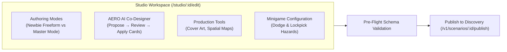
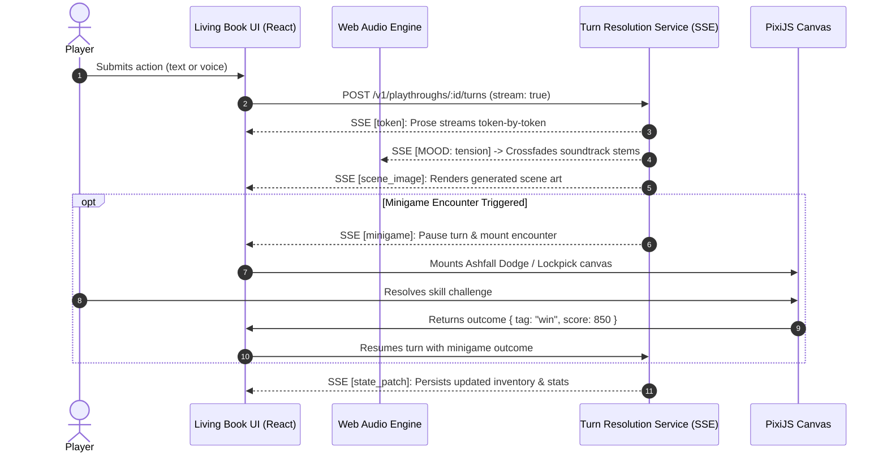

# sands Frontend (`apps/frontend`)

> **5-Minute Technical Tour & Architecture Overview**  
> A high-level guide for tech leads and contributors covering UI surfaces, core flows, multimedia capabilities, and architecture patterns.

---

## 1. What is the Frontend?

The `apps/frontend` package is the single-page web client for **sands** (Sands), an interactive storytelling platform where players experience cinematic, text-based RPGs driven by Gemini AI and persistent world memory.

The client is built around two primary user loops:
1. **The Creator Loop (`/studio`)**: Authoring rich interactive worlds—from freeform lore in *Newbie Mode* to structured state machines, rule invariants, and minigame encounters in *Master Mode*, assisted by AERO (an in-editor AI co-designer).
2. **The Player Loop (`/play`)**: Reading, listening, and influencing living stories through the *Living Book E-Reader*—featuring token-by-token SSE prose streaming, AI-generated scene art, voice input/output, interactive PixiJS minigames, and a dynamic soundtrack that crossfades with the story's emotional mood.

---

## 2. Tech Stack at a Glance

| Layer | Technology | Key Responsibility |
|---|---|---|
| **Core Framework** | React 18, Vite 8, TypeScript 5 (Strict) | Component hierarchy, fast HMR, and strict typing. |
| **Routing** | React Router v7 (`react-router-dom`) | Surface routing and lazy-loaded code-splitting. |
| **Server State** | TanStack React Query v5 | API queries, mutations, cache invalidation, and optimistic updates. |
| **Client UI State** | Zustand v4 | Ephemeral UI states (drawers, audio toggles, active tabs, SSE status). |
| **Styling & Motion** | Tailwind CSS 3, Motion 12 | Atmospheric dark fantasy styling, layout grids, and animations. |
| **Interactive Canvas** | Pixi.js v8 & HTML5 Canvas | High-performance 2D minigames (*Ashfall Dodge*, *Lockpick*). |
| **Audio Engine** | Web Audio API (`ambient-soundtrack.ts`) | Real-time multi-stem adaptive music crossfading based on mood tags. |
| **Auth & Network** | Firebase Auth v12, Axios, Native SSE | Google Sign-In exchange, REST calls, and streamed turn narration. |

---

## 3. Architecture Topography & Directory Structure

The application enforces strict modular boundaries under `src/`:

```
apps/frontend/src/
├── app/                  # Application root, React Router routes, and QueryClientProvider
├── features/             # Self-contained domain slices (strictly isolated)
│   ├── studio/           # Scenario authoring, AERO co-designer, schema & map editors
│   ├── play/             # Living Book reader, turn orchestration, action drawers
│   ├── onboarding/       # 5-step welcome wizard (genres, voice, typography)
│   ├── profile/          # User library, playthroughs, bookmarks, author stats
│   ├── auth/             # Firebase Google login & backend JWT session management
│   ├── landing/          # Hero showcase and public scenario showcase
│   └── misc/             # 404, error fallbacks, and layout boundaries
└── shared/               # Reusable primitives shared across features
    ├── components/       # Design system (buttons, modals, tooltips) & minigame canvases
    ├── hooks/            # useSSE, useAudio, useVoiceOutputPreference
    ├── lib/              # API clients, SSE stream hub, audio engines, Firebase setup
    ├── stores/           # Cross-cutting client stores (readerPreferences, etc.)
    └── types/            # Shared DTOs, minigame interfaces, and domain models
```

### Core Architectural Invariants

* **Feature Boundary Isolation**: Features never import from sibling features (e.g., `features/studio` cannot import from `features/play`). Anything shared across domains lives in `src/shared/`.
* **Strict State Separation**:
  * **React Query** manages *all* server data. Direct `useEffect` + `useState` fetching patterns are banned.
  * **Zustand** manages *only* client UI state (panels, audio volume, draft selections). Server data is never mirrored in Zustand.
* **Centralized SSE Streaming**: Components never instantiate `EventSource` directly. All streaming flows through `src/shared/hooks/useSSE.ts` wrapped by domain hooks like `useTurnStream`.

---

## 4. Core Surface 1: Studio Authoring Suite (`/studio`)

The Studio provides storytellers with a full creative workstation to build, inspect, and publish interactive scenarios.



### Key Capabilities

* **Dual Creation Modes**:
  * **Newbie Mode**: A simplified flow focused on prose world lore, tone directives, and setting descriptions where Gemini narrates freely.
  * **Master Mode**: Full state machine design: custom entity schemas, numerical trackers, faction standings, rule invariants, and programmatic win/lose conditions.
* **AERO AI Co-Designer (`AIChatSidebar`)**:
  * An embedded assistant that inspects the live scenario state and proposes atomic modifications (entities, rules, triggers) formatted as interactive review cards.
  * Authors can accept, modify, or reject proposals individually or apply them in bulk.
* **Spatial Map Editor (`MapEditor`)**:
  * Interactive image canvas where authors place location pins, assign encounter zones, and define navigation paths for players.
* **Production Media & Minigames**:
  * **Vertex AI Cover Art**: Prompt-driven cover art generation with Cloudflare R2 storage.
  * **Minigame Hazards**: Configure mid-turn skill challenges (hazard density, speed, win/loss state mutations).
* **Validation & Publish Pipeline (`PublishFlow`)**:
  * Validates invariant integrity and state consistency before registering the scenario with Core API and indexing it in the memory service.

---

## 5. Core Surface 2: Play Engine & Living Book (`/play`)

The Play surface delivers the interactive narrative experience, combining e-reader ergonomics with real-time AI game mastering.



### Key Capabilities

* **Living Book E-Reader (`EBook`)**:
  * Parchment-inspired aesthetic with customizable typography, page scaling, and font preferences stored in `readerPreferences.store.ts`.
  * Inline codex tooltips (`EntityInspectTooltip`) allowing players to hover over underlined characters, factions, or artifacts to inspect lore retrieved from long-term memory.
* **Real-Time Turn Streaming (`useTurnStream`)**:
  * Submits player choices to Turn Resolution Service (TRS) and streams prose token-by-token with zero buffering.
  * Renders dynamically generated per-turn scene images inline as the scene unfolds.
* **Adaptive Soundtrack (`ambient-soundtrack.ts`)**:
  * Web Audio system that monitors inline narration mood tags (e.g., `[MOOD: mysterious]`, `[MOOD: tension]`, `[MOOD: triumph]`) and smoothly crossfades ambient audio stems to match the current narrative tension.
* **Action Drawer & Voice Input**:
  * Collapsible drawer offering freeform text submission, suggested contextual choices, and integrated voice input (Web Speech / audio recorder).
* **Interactive Minigames (`shared/components/minigames/`)**:
  * Canvas-rendered minigames (*Ashfall Dodge* with PixiJS and *Lockpick*).
  * Seamlessly intercept turns when triggers fire, resolving the player's reflexes and feeding outcome tags back to Gemini to determine narrative consequences.
* **Spectator Mode (`/spectate/:id`)**:
  * Read-only live playback mode connecting to TRS spectator streams for watching ongoing playthroughs.

---

## 6. Supporting Surfaces

* **Discovery & Landing (`/`, `/discover`)**:
  * Scenario exploration feed, featured carousels, genre filtering, and community reviews.
* **Onboarding Wizard (`/welcome`)**:
  * 5-step first-run wizard capturing preferred genres, e-reader typography, narrator voice preferences, and player identity.
* **User Profile & Library (`/profile`)**:
  * Tracks completed campaigns, active playthroughs, created scenarios, and community ratings.
* **Auth Guard & Session Management (`features/auth`)**:
  * Firebase Google Sign-In exchanged with Core API (`/v1/auth/token`) for an internal HMAC JWT. Tokens are automatically refreshed and attached to outgoing requests.

---

## 7. Developer Quickstart & Tooling

### Setup & Local Development

From the repository root or `apps/frontend`:

```bash
# Install dependencies
npm install

# Start Vite hot-reload dev server (runs on http://localhost:5173)
npm run dev

# Run full TypeScript check and production build
npm run build
```

### Environment Configuration (`apps/frontend/.env.local`)

```env
VITE_CORE_API_URL=http://localhost:8000
VITE_TRS_API_URL=http://localhost:8001
VITE_FIREBASE_API_KEY=your-api-key
VITE_FIREBASE_AUTH_DOMAIN=your-project.firebaseapp.com
VITE_FIREBASE_PROJECT_ID=your-project-id
```

### Verification & Quality Gates

```bash
# Run ESLint (strictly enforced with zero warnings)
npm run lint

# Run unit and integration tests (Vitest + MSW)
npm test

# Detect dead code or orphaned exports
npm run dead-code
```

---

## Related Documentation

* [`CLAUDE.md`](../../CLAUDE.md) — Universal coding rules, TypeScript guidelines, and architecture constraints.
* [`ARCHITECTURE.md`](../../ARCHITECTURE.md) — System-wide architecture and C4 service diagrams.
* [`docs/arch/frontend/overview.md`](../../docs/arch/frontend/overview.md) — Detailed frontend architecture specifications.
* [`docs/CODEBASE_GUIDE.md`](../../docs/CODEBASE_GUIDE.md) — Feature-to-file reference guide.
