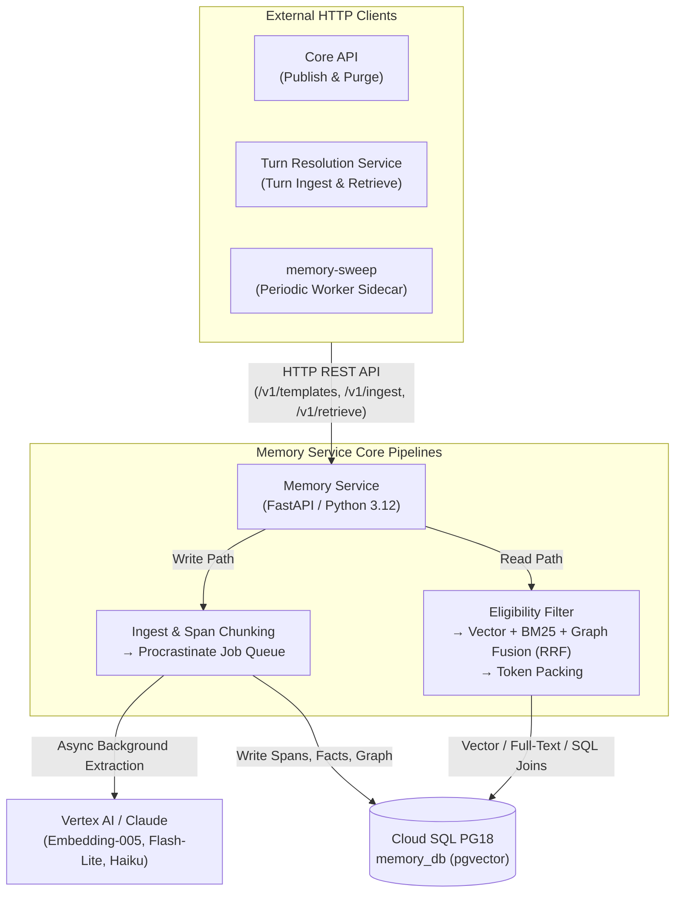

# Memory Service — 5-Minute Architecture & Developer Guide

> **Reading time:** ~5 minutes  
> **Service path:** [`apps/memory/`](apps/memory)  
> **Tech stack:** Python 3.12+, FastAPI, async `psycopg` 3 (`psycopg_pool`), PostgreSQL 18 with `pgvector`, Procrastinate (Postgres task queue), Google Vertex AI (`text-embedding-005`, `gemini-3.5-flash-lite`), Claude Haiku 5.5, Pydantic v2  
> **Primary contract:** [CLAUDE.md](CLAUDE.md) · [ARCHITECTURE.md](ARCHITECTURE.md) · [docs/memory-specs/](docs/memory-specs/README.md)

---

## 1. Executive Summary & System Role

The **Memory Service** (Greenfield Memory Engine, ADR-15) is the long-term episodic and world memory engine for **sands**. It provides grounded fact storage, entity relationship graphs, and hybrid semantic retrieval across turns, ensuring the AI narrator maintains strict world and state consistency throughout a campaign.

Architecturally, the memory engine decouples into two independent pipelines:
1. **The Write Path (Asynchronous & Ingest-Driven)**: Ingests transactional outbox events from gameplay turns, splits narrative into semantic spans, schedules background vector embeddings, and executes batched LLM extraction to distill narration and state mutations into durable facts and commitments.
2. **The Read Path (Synchronous & Per-Turn)**: Executes hybrid Reciprocal Rank Fusion (RRF) across vector, keyword, and knowledge-graph branches, filtered by state eligibility and token-budget packed for the narrator prompt.



---

## 2. Hard Boundaries & Invariants (Never Violate)

Every engineer and agent working in or integrating with Memory must preserve these architectural rules:

1. **Strict External System Boundary (ADR-6, ADR-15)**: Neither Core API nor TRS may ever import Python code from `apps/memory/` directly. All communication occurs over HTTP via each service's own [`integrations/memory_client.py`](apps/core-api/app/integrations/memory_client.py).
2. **Isolated Database Catalog (`memory_db`)**: Memory owns its own distinct PostgreSQL catalog (`memory_db`). It **never** touches `sands_db`, and neither Core API nor TRS ever connect to `memory_db`.
3. **Async Psycopg 3 & Raw SQL (No SQLAlchemy / No Alembic)**:
   - Data access is implemented with raw SQL in `app/repositories/` using async `psycopg` 3 and `psycopg_pool`.
   - Database migrations are sequential, forward-only SQL files (`0001`–`0007`) in `app/db/migrations/`, executed via [`app/db/migrate.py`](apps/memory/app/db/migrate.py) (run by the `memory-migrate` container).
4. **Python 3.12+ & Import Layering (`lint-imports`)**:
   - Requires Python $\ge 3.12$.
   - Layering (`Router → Service → Repository / Integration`) is strictly verified by `[tool.importlinter]` contracts in `pyproject.toml`. Run `lint-imports` after adding any import.
   - Runtime service code must never import benchmarking tools from `apps/memory/eval/`.
5. **Master Mode vs. Newbie Mode Authoring Invariant**:
   - **Master Mode**: Lore, entities, and facts defined by the author are mapped 1:1 and written directly to `memory_db` with **zero LLM extraction** at publish. Running author-specified master rules through an LLM is strictly banned.
   - **Newbie Mode**: Freeform narrative lore is chunked and enriched asynchronously through the LLM extraction pipeline.
6. **No Cloned State (Read Once, Pin Revision)**:
   - Playthroughs do not clone or copy scenario templates.
   - A playthrough pins a scenario's `memory_publish_revision`. At retrieval time, the query targets the union of the pinned scenario template scope and the playthrough's own runtime scope.

---

## 3. The Dual Pipelines: Write vs. Read

### 3.1 The Write Path (Ingest $\longrightarrow$ Embed $\longrightarrow$ Extract $\longrightarrow$ Supersede)

1. **Intake (`POST /v1/ingest/items`)**:
   - Idempotently ingests batches of transactional outbox items (`registration`, `turn`, `flush`, `participants`).
   - Deduplicates items via `ingest_delivery_repo`.
   - Splits narration text into semantic spans capped at `span_max_tokens` (default 300 tokens, ~900 characters) via `span_splitter.py`.
2. **Embedding & Extraction Queue (`POST /v1/jobs/process-pending`)**:
   - The `memory-sweep` sidecar triggers processing periodically.
   - **Embeddings**: Computes 768-dimensional embeddings using `text-embedding-005` in batches of 100 with exponential backoff retry.
   - **Batched LLM Extraction**: Background Procrastinate jobs group turns into 5-turn windows. Vertex AI (`gemini-3.5-flash-lite` or `claude-haiku-5-5`) extracts candidate entities, relationships, facts, and commitments.
3. **Validation, Application & Supersession**:
   - Extracted facts are code-validated against schema invariants.
   - **Supersession Pass**: If a new fact contradicts or updates an existing functional attribute (e.g. `location`, `owner`, `status`), the previous fact is marked superseded, preventing outdated historical states from polluting future turns.

### 3.2 The Read Path (Retrieve $\longrightarrow$ Filter $\longrightarrow$ Hybrid RRF $\longrightarrow$ Pack)

When TRS prepares to generate narration, it invokes `POST /v1/retrieve`:

1. **Eligibility Filter**:
   - Evaluates state constraints (location bounds, active conditions, character inventory) before scoring candidates, drastically pruning candidate search space.
2. **3-Branch Hybrid Retrieval**:
   - **Vector Branch**: `pgvector` cosine similarity searching span embeddings and fact embeddings.
   - **Keyword Branch**: Full-text PostgreSQL `tsvector` matching player action tokens against entity names, aliases, and facts.
   - **Graph Branch**: Knowledge graph neighborhood expansion starting from active entities, traversing relationship edges (`relations`, `aliases`) up to 2 hops.
3. **Reciprocal Rank Fusion (RRF)**:
   - Fuses results across all three branches using $RRF(d) = \sum_{b \in B} \frac{1}{k + r_b(d)}$ with $k = 60$.
4. **Greedy Token Packing**:
   - Deduplicates fused candidates and greedily packs facts, commitments, and entity descriptors into a formatted context block respecting `recall_budget_tokens` (default 2,000 tokens).

---

## 4. API Endpoints & Operational Topology

| Router | Path | Primary Purpose |
|---|---|---|
| [`templates.py`](apps/memory/app/routers/templates.py) | `POST /v1/templates` | Compiles scenario template at publish (master 1:1 or newbie chunked). |
| [`ingest.py`](apps/memory/app/routers/ingest.py) | `POST /v1/ingest/items` | Idempotent outbox item ingestion and span chunking. |
| [`retrieve.py`](apps/memory/app/routers/retrieve.py) | `POST /v1/retrieve` | Per-turn hybrid RRF retrieval and token-budget context packing. |
| [`jobs.py`](apps/memory/app/routers/jobs.py) | `POST /v1/jobs/process-pending` | Triggers background embedding calculations and Procrastinate batch extraction. |
| [`playthroughs.py`](apps/memory/app/routers/playthroughs.py) | `POST /v1/playthroughs/{id}/memory/retry` | On-demand forced sync for playthroughs experiencing memory lag. |
| [`purge.py`](apps/memory/app/routers/purge.py) | `POST /v1/purge` · `GET /v1/scopes` | Purges all memory data for deleted playthroughs, scenarios, or users. |
| [`health.py`](apps/memory/app/routers/health.py) | `GET /health` | Liveness and database connectivity check. |

### Operational Sidecars in `docker-compose.yml`:
- **`memory-migrate`**: Runs `python -m app.db.migrate` on startup before service boot.
- **`memory-sweep`**: Periodic `curl` runner triggering TRS outbox relay and Memory `/v1/jobs/process-pending`.
- **`memory-maintenance`**: Daily runner executing outbox row pruning and orphan scope reconciliation.

---

## 5. Engineering Standards & Coding Rules ([CLAUDE.md](CLAUDE.md))

- **Async Connection Pooling**: Always acquire connections via `async with pool.connection() as conn:` from `app/db/pool.py`. Never block the event loop.
- **Complexity Limits**: Maximum nesting depth $\le 2$; maximum function length $\le 30$ lines.
- **No Untyped Dictionaries**: Strictly type all service inputs and outputs with Pydantic v2 models.
- **No Hallucinated Docstrings**: Write comments/docstrings only to explain non-obvious *why* or algorithms (e.g. RRF fusion thresholds). Never restate code logic.

---

## 6. Developer Cheatsheet & Common Commands

Run commands from `apps/memory/`:

```bash
# Start memory service locally on port 8080:
uvicorn app.main:app --host 0.0.0.0 --port 8080 --reload

# Apply database migrations to memory_db:
python -m app.db.migrate

# Check architecture import boundaries (strictly enforced):
lint-imports

# Run standard test suite (skipping live API calls):
pytest tests/

# Run live integration benchmarks (requires GOOGLE_CLOUD_API_KEY):
pytest tests/ -m "live_embedding or live_extraction"

# Format and lint code (must pass with 0 warnings):
ruff format .
ruff check . --fix
```

---

> 📖 **Deep Dive Specs:** For algorithm details, evaluation benchmarks, and database schemas, see [`docs/arch/memory/overview.md`](docs/arch/memory/overview.md), [`docs/memory-specs/`](docs/memory-specs/README.md), and the interactive architecture diagram at [`docs/arch/sands-memory-architecture.html`](docs/arch/sands-memory-architecture.html).
