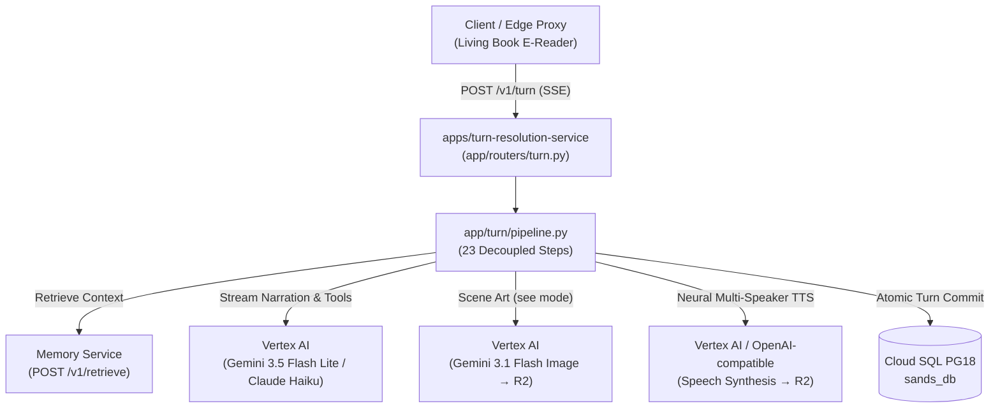

# Turn Resolution Service (TRS) — 5-Minute Architecture & Developer Guide

> **Reading time:** ~5 minutes  
> **Service path:** [`apps/turn-resolution-service/`](apps/turn-resolution-service)  
> **Tech stack:** Python 3.11+, FastAPI, SQLAlchemy 2.0 (async), asyncpg, Google Vertex AI (Gemini 3.5 Flash Lite, Chirp 3, Gemini TTS), Claude Haiku, sse-starlette, Pydantic v2  
> **Primary contract:** [CLAUDE.md](CLAUDE.md) · [ARCHITECTURE.md](ARCHITECTURE.md)

---

## 1. Executive Summary & System Role

The **Turn Resolution Service (TRS)** is the stateful gameplay engine and AI narrator for **sands**. Every time a player speaks, acts, examines the scene, or rolls a check, TRS drives the story forward in real time. It is the sole service in the entire monorepo permitted to call LLMs for narration, and the only service with live Server-Sent Events (SSE) streaming.



### What Lives Here vs. Elsewhere

| Service | Primary Responsibility | AI & Streaming Invariant |
|---|---|---|
| **Turn Resolution Service (TRS)** (`apps/turn-resolution-service`) | Live gameplay turn resolution loop, action execution, narrative generation, interactive minigames, multi-speaker voice, spectator streaming. | **All gameplay narration AI.** Live SSE streaming (`POST /v1/turn`). Voice STT/TTS. |
| **Core API** (`apps/core-api`) | Stateless CRUD, scenario authoring in Studio, scenario publish & memory template compilation, discovery feed, user auth. | **Stateless REST only.** No narration LLM. No SSE streaming. |
| **Memory Service** (`apps/memory`) | Long-term world facts, transactional outbox ingestion, graph/vector/keyword hybrid retrieval. | Vertex AI embeddings & fact extraction. Standalone HTTP service. |

---

## 2. Hard Boundaries & Invariants (Never Violate)

Every engineer and agent working in TRS must strictly preserve these invariants:

1. **Exclusive Narration Owner**: Gameplay narration LLMs are called **only** through [`app/integrations/gemini_client.py`](apps/turn-resolution-service/app/integrations/gemini_client.py) or [`anthropic_client.py`](apps/turn-resolution-service/app/integrations/anthropic_client.py). No other file in this service—and no other service in the repository—may call an LLM for narration.
2. **Immediate Streaming**: SSE responses must stream tokens immediately as they arrive from Vertex AI. **Buffering a complete Gemini response before sending is strictly a bug.**
3. **Pipeline Step Isolation**: [`app/turn/pipeline.py`](apps/turn-resolution-service/app/turn/pipeline.py) is the **only file that knows step order**. Step modules in [`app/turn/steps/`](apps/turn-resolution-service/app/turn/steps) must never call or import each other.
4. **Scenario Immutability**: TRS is strictly read-only on `Scenario` records, with exactly **one exception**: incrementing `Scenario.play_count` at turn 10. TRS never modifies any other scenario field.
5. **Database Model Sharing**: TRS connects to the shared `sands_db` database but **owns zero Alembic migrations** (owned by Core API). TRS maintains lightweight, unjoined SQLAlchemy models in `app/db/models/` for minimal per-turn overhead.
6. **Quota Gates & Graceful Degradation**:
   - Turn quota is checked upfront; exceeding daily limits throws a standard HTTP 429 (`RateLimitExceededError`).
   - Scene images and voice TTS reserve separate daily quotas. Exhausting an image or voice quota emits a `quota_notice` SSE event and skips generation—it **never fails or aborts the turn**.

---

## 3. The 23-Step Turn Resolution Pipeline

When a player submits an action (`POST /v1/turn`), [`pipeline.py`](apps/turn-resolution-service/app/turn/pipeline.py) executes 23 discrete step modules across 6 phases:

| Phase | Step # | Step Module | Responsibility & Behavior |
|---|---|---|---|
| **I. Intake & Replay** | 1 | `turn_replay.py` | Fast idempotency check: looks up `client_action_id` on `TurnLog`. If already committed, replays past turn data immediately without quota usage or AI calls. |
| | 2 | `request_receiver.py` | Validates session status, turn order, participant ownership. Cuts text at `turn_action_max_chars` (2,000 chars, emitting `input_truncated`); rejects $> 20,000$ chars (HTTP 422). |
| | 3 | `state_loader.py` | Deep copies `Playthrough.state` and `scenario_snapshot`. Reserves the user's daily turn quota. |
| **II. Pre-Narration Resolvers** | 4 | `rule_check_resolver.py` | *(Tool: `rule_checks`)* If `action_kind == "check_report"`: acquires row lock, validates timeliness & answers, applies mutations, yields `check_resolved`. |
| | 5 | `minigame_result_resolver.py` | *(Master only)* If `action_kind == "minigame_result"`: validates `attempt_id`, applies win/loss mutations, clears `_pending_minigame`. |
| | 6 | `check_result_resolver.py` | *(Master only)* Evaluates dice rolls vs DC, applies modifiers, passes context to the prompt. |
| | 7 | `condition_evaluator.py` | *(Master only)* Evaluates active conditions, applies state mutations, and yields `sensory_cue` audio/visual events. |
| | 8 | `state_update_builder.py` | Yields `state_update` before narration with player-visible attributes and revealed rule sheet elements. |
| **III. Context & Prompting** | 9 | `context_retrieval.py` | Calls memory service (`POST /v1/retrieve`) with eligibility filters. Fails open to empty context if memory service lags. |
| | 10 | `ai_orchestrator.py` | Assembles prompt enforcing **Prompt Prefix Stability** (ADR-21). Streams `narration` chunks and `mood` tags via Gemini 3.5 Flash Lite. |
| **IV. Tools & State Sync** | 11 | `tool_handler.py` | *(Master only)* Executes approved Gemini tool calls (`set_field`, `adjust_numeric_field`, `add_inventory_item`, etc.). |
| | 12 | `state_validator.py` | *(Master only)* Validates proposed mutations against Pydantic schema invariants, rejecting illegal state changes. |
| | 13 | `map_state_sync.py` | *(Master only)* Updates `discovered_location_ids` when `current_location_id` changes. |
| | 14 | `minigame_trigger_evaluator.py` | *(Master only, solo)* Evaluates minigame triggers. On match, stamps `_pending_minigame`, yields `minigame` event, and suppresses end conditions. |
| | 15 | `rule_check_trigger_evaluator.py` | *(Tool: `rule_checks`)* Evaluates rising-edge trigger conditions; queues checks and yields `check` event. |
| **V. Generative Media & Diffs** | 16 | `scene_image_generator.py` | If `action_mode == "see"`: prompts `gemini-3.1-flash-image` with location entity lore, uploads to R2, yields `scene_image`. |
| | 17 | `narration_audio_generator.py` | If voice enabled: synthesizes speech via Gemini TTS with multi-speaker tags and voice pooling, uploads to R2, yields `narration_audio`. |
| | 18 | `turn_summary_builder.py` | *(Master only)* Aggregates stat deltas, inventory changes, and rolls into `turn_summary` SSE payload. |
| **VI. Persistence & Delivery** | 19 | `state_writer.py` | Atomically commits `TurnLog`, `Playthrough.state`, `memory_outbox` delivery row, and `turn_metrics` in Postgres. |
| | 20 | `end_condition_evaluator.py` | *(Master only)* Evaluates terminal win/lose outcomes; emits `playthrough_ended` if matched. |
| | 21 | `memory_delivery.py` | Best-effort inline HTTP delivery of staged `memory_outbox` rows to memory service (`POST /v1/ingest/items`). |
| | 22 | `memory_degraded.py` | Yields diagnostic `memory_degraded` event if memory ingestion or extraction is lagging. |
| | 23 | `response_streamer.py` | Terminal wrapper formatting frames into standard SSE, concluding with `done` or `degraded`. |

---

## 4. The 16 SSE Events Catalog

Every `POST /v1/turn` stream emits a subset of these 16 standard event types:

```
input_truncated    --> Narrative text exceeded 2,000 characters and was trimmed
check              --> Proposed dice check or timed rule check prompt
check_resolved     --> Result of a resolved dice check or client rule check
sensory_cue        --> Atmospheric cue (sound effect, flicker, vignette)
state_update       --> Player-visible state and revealed rules sent before narration
narration          --> Streamed markdown text tokens of the narrator
mood               --> Scene mood classification (peaceful, mystery, tension, combat, etc.)
quota_notice       --> Emitted when scene image or TTS was skipped due to daily quota
scene_image        --> Signed Cloudflare R2 URL for generated location art
narration_audio    --> Signed Cloudflare R2 URL for multi-speaker synthesized speech
turn_summary       --> Structured delta payload (stats, inventory, condition diffs)
minigame           --> Minigame trigger payload for full-screen canvas game
playthrough_ended  --> Terminal outcome event (win or loss outcome tag and description)
memory_degraded    --> Non-blocking notice that memory service is degraded
done               --> Terminal event successfully closing the SSE connection
degraded           --> Terminal event closing the stream on unrecoverable generation error
```

---

## 5. Voice & Interactive Systems

### 5.1 Voice Input & Output Architecture
- **Speech-to-Text (STT)**: [`routers/voice.py`](apps/turn-resolution-service/app/routers/voice.py) exposes `POST /v1/voice/transcribe`, calling Google Cloud Speech-to-Text V2 (Chirp 3) via [`speech_client.py`](apps/turn-resolution-service/app/integrations/speech_client.py).
- **Multi-Speaker TTS**: Narration is annotated with `[NARRATOR]` and `[NPC: <Name>]` tags. Step 17 maps speakers to voices via a deterministic voice pool (`Puck`, `Charon`, `Fenrir`, `Aoede`, `Orus`, `Zephyr`), synthesizes audio, and stores MP3s in Cloudflare R2.

### 5.2 Studio Co-Writer Assistant ([`routers/assistant.py`](apps/turn-resolution-service/app/routers/assistant.py))
`POST /v1/studio/assistant` streams suggestions and feedback directly to authors editing scenarios in the Studio, leveraging Vertex AI without persisting playthrough state.

### 5.3 Multiplayer & Live Spectating ([`session/`](apps/turn-resolution-service/app/session))
- **Notification Stream (`GET /v1/session/{id}/notifications`)**: Lightweight SSE stream that pushes `your_turn` events to the active player.
- **Spectator Stream (`GET /v1/session/{id}/spectate`)**: In-process `spectator_manager` mirrors all 16 turn events in real time to spectators.

---

## 6. Engineering & Coding Standards ([CLAUDE.md](CLAUDE.md))

- **Prompt Prefix Stability (ADR-21)**: Vertex AI caches only a byte-identical prefix. Prompts assembled in [`context_assembly.py`](apps/turn-resolution-service/app/turn/context_assembly.py) must strictly order: `global rules → scenario lore → playthrough history → per-turn volatile action`. Never place timestamps, random values, or UUIDs ahead of the volatile tail.
- **Function Complexity**: Maximum nesting depth $\le 2$; maximum function length $\le 30$ lines.
- **Strict Typing**: Type hints on all parameters and returns. No `typing.Any` (use `dict[str, object]` if untyped).
- **Async I/O**: Never use blocking I/O or `asyncio.run()` in async contexts.
- **Error Handling**: Raise explicit domain exceptions from `app/exceptions/turn_exceptions.py`.

---

## 7. Developer Cheatsheet & Common Commands

Run commands from `apps/turn-resolution-service/`:

```bash
# Start TRS locally on port 8001:
uvicorn app.main:app --host 0.0.0.0 --port 8001 --reload

# Run full test suite:
pytest tests/

# Run unit tests only (skipping slow integration tests):
pytest tests/ -m "not integration"

# Run a specific pipeline test:
pytest tests/turn/test_pipeline_replay.py

# Format and lint code (must pass with 0 warnings):
ruff format .
ruff check . --fix
```

---

> 📖 **Deep Dive Architecture Reference:** For step sequence diagrams and state mutation specifications, see [`docs/arch/turn-resolution-service/overview.md`](docs/arch/turn-resolution-service/overview.md) and the interactive pipeline sequence viewer at [`docs/arch/sands-turn-pipeline-sequence.html`](docs/arch/sands-turn-pipeline-sequence.html).
